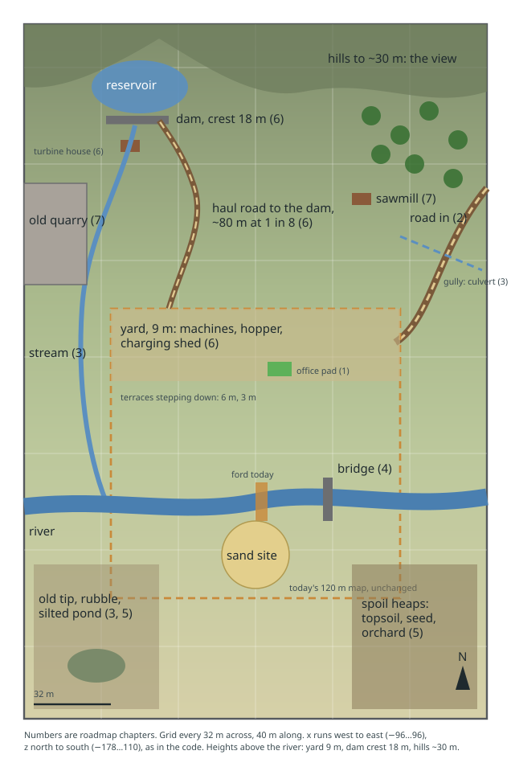

# The valley: layout

Where everything the roadmap (`docs/roadmap.md`) needs will be built, so each chapter goes where it will stay. Numbers in brackets are roadmap chapters. The decisions below were agreed with the owner; the coordinates are a plan, to be adjusted when each area is built.

## The decisions

| | Decision | Why |
|---|---|---|
| Size | **192 m wide × 288 m long**, the long way running north–south | The same ground as 240 × 240 m (the same engine cost), but the drive from the river to the dam takes about a minute at working speed, so it feels like going somewhere. No bigger until it has run on a Quest. |
| Shape | **Falls from north to south**: hills and the dam at the head, the river across the foot | Water runs the way you expect, and the view opens out as you climb. |
| Theme | **A worn-out quarry valley**: an old quarry, its tip and spoil, a silted pond and a stream running wild | It explains the mess you start with, and suits the steampunk end, where the old quarry gear finds new work. The feel is taken from real valleys like that, not copied from one. |
| Heights | **Yard 9 m, dam crest 18 m, hills about 30 m** (above the river) | A haul road climbs about 1 in 8 to 1 in 10, so the 9 m from the yard to the crest needs about 80 m of road, which fits. The hills behind are for the view and are not driven. |
| Order | **As the roadmap has it**: the bridge (4) before the orchard (5) | The ford already gets machines south, so nothing waits on the bridge. |
| Players | **A valley each**: named sites such as "Family" and "Friends", and a site file to move one between computers | The world lives on whoever hosts. Family on Quests and friends on PCs would otherwise fight over one save; the family valley also has to keep within the Quest's limits. |

## Size and coordinates

- x runs west to east from −96 to 96; z runs north to south from −178 to 110, as in the code (north is negative z). Cells stay at 0.25 m: 768 × 1152 cells.
- **Today's 120 m map sits unchanged** at x −60…60, z −60…60: the yard at 9 m, the terraces, the river, the ford and the sand site keep their coordinates, so saved sites, tests and scripted drivers that use today's map keep working.
- Most of the extra length goes north, for the climb to the dam and the reservoir behind it. The south gains about 50 m, for the tip and the spoil heaps.

## What goes where

| Area | Where (x, z) | Chapter | What it is for |
|---|---|---|---|
| Yard and office pad | today's, about (0, −45) | 1 | Machines, hopper, the site office on its levelled pad; later the charging shed (6) |
| Road in | from the east edge (96, −110), down along the slope to the yard (58, −46) | 2 | A rough track to build up, roll and open to supply trucks |
| Gully | across the road in, about (78, −82) | 3 | Run-off from the woodland crosses the road: a culvert job |
| Stream | from the dam (−50, −136) down the west side (x ≈ −72) to the river at (−62, 20) | 3, 6 | Runs wild past the quarry and the terraces until it is drained and dammed |
| Old tip and silted pond | south-west, (−92…−40, 46…106) | 3, 5 | Rubble and a silted pond: drainage, then a clean pond |
| River | across the valley, z ≈ 20 | 3, 4 | Today's river, carried on to both edges |
| Bridge site | (30, 18), a narrow, firm-banked reach | 4 | Abutments, footings, a deck lifted on; replaces the ford |
| Spoil heaps | south-east, (40…92, 46…106) | 5 | Bare, poor ground to topsoil, seed and plant as an orchard |
| Haul road to the dam | from the yard's north-west corner (−36, −60) to the crest (−40, −138), about 80 m at 1 in 8 | 6 | Cut along the slope; the first real road gradient |
| Dam and reservoir | dam across the stream at z ≈ −138, x −62…−36; water behind it to z ≈ −165 | 6 | An earth dam: grading, compaction and drainage in one job |
| Turbine house | below the dam, (−52, −128) | 6 | Power; a cable trench from it to the yard, about 70 m |
| Old quarry | west, (−96…−70, −112…−70) | 7 | A rock face: stone for roads and the bridge, so deliveries can stop |
| Woodland and sawmill | north-east, (40…92, −150…−110); sawmill at (44, −106) | 7 | Timber; the trees also shed the gully's water |

## How it starts, and how it ends

- **At the start it is a mess:** the tip and spoil heaps in the south, a silted pond, bare and gullied banks, and the stream running wild down the west side past the old quarry. Today's yard is the one tidy corner.
- **By chapter 7:** a road in, a bridge, drained slopes, a clean pond, an orchard on the old spoil, a dam and turbine, electric machines charging in the yard, and the quarry and sawmill supplying everything.

## Sites and players

- Each group has its own valley, saved under a name ("Family", "Friends", or anything else) in the browser of whoever hosts. The start page lists them, makes new ones and deletes old ones.
- **A site file** carries a valley between computers: export it from one start page, import it on another. It is small, because a save holds only the ground that was worked.
- Graphics follow the computer, not the site: the family valley on a Quest draws at the Quest tier; opened on a PC it can use the PC tiers.

## What the engine can carry

Measured on a 240 m test map (`?map=xl`: today's layout on the same amount of ground as the valley), desktop software rendering. These show how cost scales, not Quest frame rates.

| | 120 m today | 240 m |
|---|---|---|
| Draw calls, standing in the yard | 100 | 136 (budget 150) |
| Triangles, standing in the yard | 287k | 363k |
| Terrain simulation per tick | under 1 ms | under 1 ms (untouched ground costs nothing) |
| Load to first frames | 3.2 s | 4.5 s (mostly the river settling at start-up) |
| Save, and a newcomer's download in co-op | 0.6 MB | 0.6 MB (only worked ground is kept and sent) |

## Work before the valley can be built

1. **Water in more than one place** (the first step): the stream, the reservoir and the pond, not only the river band. Being built now.
2. **Named sites and site files** (above). Done: `src/ui/sites.js`, `src/game/siteFile.js`, `tests/e2e/sites.mjs`.
3. **The scenery follows the map's size:** the backdrop and tree ring are placed for the 120 m map.
4. **Rock:** the quarry needs a hard material that only breaks with ripping. `ROCK` exists as a material, but nothing digs it yet.
5. **Maps built from named features** (hills, stream, river, pads, tip), so each chapter can adjust its own area without touching the rest.
6. **The river warm-up:** about 1 s of start-up per 60 m of river. If the stream and reservoir add much, cache the settled water.
